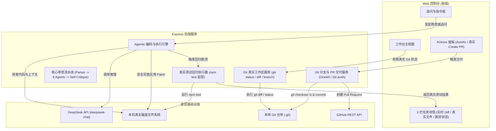

# CodeRabbit 生产级系统架构规格书 (Technical Specification)
> 基于 Matt Pocock Engineering Skills (`research` -> `to-spec` -> `to-tickets`)  
> 对标官方规约：https://docs.coderabbit.ai/  
> 日期：2026-10-12

---

## 1. 调研基线与事实核对 (Research Findings)

根据 CodeRabbit 官方第一手权威文档（`https://docs.coderabbit.ai/`），CodeRabbit 是一个基于 Git 与 LLM 的**生产级智能变更管理平台**。

### 1.1 现状与差距诊断
| 模块 | 官方真实机制 | 本项目既有现状 | 真实化改造要求 |
| :--- | :--- | :--- | :--- |
| **工作台任务卡片** | 实时反映沙箱内 Agent 运行的真实改动、命令输出与跑测日志 | `src/server/api.routes.ts` 硬编码了 `SqlSugarTransactionParticipation.cs`、`457 通过` 等静态假数据 | **彻底清除 Mock**，改为实时扫描当前本地 Git 仓库真实未提交改动 |
| **文件修改 (Edit)** | Agentic loop 实际修改目标沙箱中的代码文件 | 仅调用 DeepSeek 生成文本回复，从未真正将补丁写回磁盘 | **实现真实写盘**，Agent 分析后直接生成有效 Patch 并安全写入文件 |
| **回归测试 (Test Runner)**| 真实运行仓库的测试套件（如 `npm test` / `pytest`），回传真实 Exit Code 与通过率 | 界面直接静态输出 `457 通过，0 失败` | **执行真实子进程跑测**，捕获真实的测试套件通过/失败数据 |
| **分支交付 (Branch / PR)** | 真实创建 `coderabbit/...` 分支，推送到远程并调用 GitHub REST API 提 PR | 前端只弹 alert，返回静态构造的伪链接 | **接入真实 Git CLI 与 Octokit**，真正创建本地分支、Commit 并支持一键创建 PR |
| **审查引擎 (Review)** | 6 个 Agent 并发审查 + Self-Critique 二阶降噪 | **已真实实现**（通过 152 项单元测试） | 保留并与真实工作区 Diff 完全打通 |

---

## 2. 真实系统架构设计 (Architecture Specification)



---

## 3. 核心 API 契约规范 (API Contracts)

### 3.1 真实工作区状态探测: `GET /api/workspace/status`
* **Response**:
  ```json
  {
    "repoName": "ai-review",
    "repoPath": "C:\\Users\\admin\\.gemini\\antigravity\\scratch\\ai-review",
    "currentBranch": "main",
    "hasChanges": true,
    "changedFiles": [
      { "path": "public/index.html", "status": "modified", "additions": 45, "deletions": 12 },
      { "path": "src/server/api.routes.ts", "status": "modified", "additions": 30, "deletions": 5 }
    ],
    "totalAdditions": 75,
    "totalDeletions": 17,
    "lastCommit": { "hash": "dd55b0e", "message": "feat(web): complete connected repositories..." }
  }
  ```

### 3.2 真实代码修改与执行循环: `POST /api/agent/execute`
* **Request**:
  ```json
  {
    "instruction": "请为 src/agents/types.ts 增加 TaskStatus 枚举并重构对应接口",
    "targetFiles": ["src/agents/types.ts"],
    "runTest": true
  }
  ```
* **Response**:
  ```json
  {
    "success": true,
    "taskId": "task_1728738912",
    "modifiedFiles": ["src/agents/types.ts"],
    "patchApplied": true,
    "testResult": {
      "command": "npm test",
      "exitCode": 0,
      "passed": 152,
      "failed": 0,
      "outputSnippet": "✓ tests/agents/types.test.ts (2 tests)"
    },
    "gitBranch": "coderabbit/patch-types-refactor",
    "commitHash": "a1b2c3d"
  }
  ```

### 3.3 真实分支提交与创建 PR: `POST /api/agent/deliver`
* **Request**:
  ```json
  {
    "taskId": "task_1728738912",
    "targetBranch": "main",
    "prTitle": "refactor: add TaskStatus enum in agents/types",
    "prBody": "### Summary\n- Added TaskStatus enum..."
  }
  ```
* **Response**:
  ```json
  {
    "success": true,
    "branch": "coderabbit/patch-types-refactor",
    "pushed": true,
    "prUrl": "https://github.com/Cosmohuang1/AICodeReview/pull/45",
    "prNumber": 45
  }
  ```

---

## 4. 质量门禁与安全策略 (Quality & Safety Gates)
1. **写盘安全隔离**：修改文件前自动备份或使用 Git 暂存区隔离，杜绝破坏未保存工作。
2. **测试结果证据主义**：必须抓取测试子进程的真实 `stdout/stderr`，严禁伪造测试数字。
3. **零 Mock 原则**：移除控制台界面中所有硬编码假数据，数据全部由真实 API 提供。
