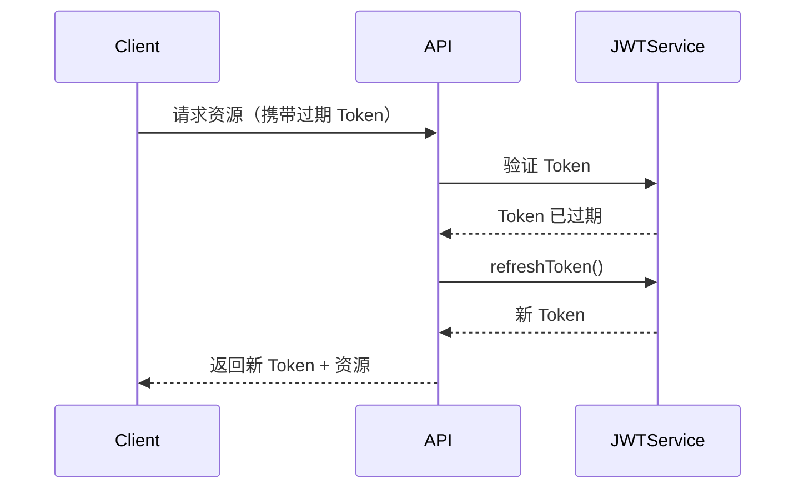

# ai-review — 设计规约 (Design Spec) v2

**日期:** 2026-10-12  
**状态:** 已审阅 ✅  
**对标产品:** CodeRabbit  
**作者:** 架构决策对话（用户 + Antigravity）

---

## 1. 产品定义

**ai-review** 是一个公司内部使用的、对标 CodeRabbit 的 AI Code Review 机器人服务。  
以 **GitHub App** 形式集成，PR 提交时自动触发审查，将结果以行级 Inline Comment + PR 摘要的形式发布到 PR 页面。底层使用 DeepSeek 大模型，支持六维度并发审查 + 二阶降噪过滤。

### 1.1 MVP 范围（第一阶段）

**✅ 包含：**
- GitHub App Webhook 接入（PR opened / synchronized 事件）
- Diff 拉取与语法感知分块（Tree-sitter）
- 6 个专项 Agent 并发审查（DeepSeek）
- Self-Critique 二阶过滤（降噪）
- PR Body 注入：Summary 摘要 + Walkthrough 变更清单 + Mermaid 结构/时序图
- 行级 Inline Comment（带 ` ```suggestion ` 一键应用代码块）
- 仓库内 `.ai-review.yml` 自定义配置
- 本地开发用 Express 服务（`npm start`，部署方式后续确定）

**❌ 不在 MVP 范围（YAGNI）：**
- GitLab / TFS 支持（第二阶段）
- 交互式对话（@ai-review 回复，第二阶段）
- Review Status（APPROVE / REQUEST_CHANGES，第二阶段）
- Web 控制台 / Dashboard
- 数据库历史记录
- 多租户 / 账户系统

---

## 2. 系统架构

### 2.1 总体数据流

```
GitHub (PR Opened / Synchronized)
    │  POST /webhook (HMAC 签名验证)
    ▼
[Webhook Server] (Express)
    │
    ▼
[Event Router]
    │  识别事件类型，过滤无关事件（非 PR / Draft PR）
    ▼
[Diff Fetcher] (Octokit REST API)
    │  拉取: PR diff + 各文件完整内容（用于上下文扩充）
    ▼
[Config Loader]
    │  从仓库根目录读取 .ai-review.yml（不存在则使用默认值）
    ▼
[Exclusion Filter]
    │  按 exclude glob 规则过滤文件（lock 文件、dist、生成代码等）
    ▼
[Diff Parser + Chunker] (unified-diff-parser + Tree-sitter)
    │  语法感知切分，每块 ≤ 8000 token，保证函数/类完整性
    ▼
[Orchestrator] (Promise.allSettled 并发)
    │
    ├─► BugAgent           (DeepSeek) → ReviewComment[]
    ├─► SecurityAgent      (DeepSeek) → ReviewComment[]
    ├─► PerformanceAgent   (DeepSeek) → ReviewComment[]
    ├─► StyleAgent         (DeepSeek) → ReviewComment[]
    ├─► TestAgent          (DeepSeek) → ReviewComment[]
    └─► CustomRulesAgent   (DeepSeek) → ReviewComment[]
    │
    ▼
[Self-Critique Filter] (DeepSeek 二阶过滤)
    │  输入原始建议 → 输出高置信度建议（过滤误报/过度挑刺）
    ▼
[Summary Agent] (DeepSeek)
    │  生成 PR 摘要 + Walkthrough 变更清单 + Mermaid 图
    ▼
[GitHub Publisher] (Octokit)
    ├─► 更新 PR Body（插入 Summary + Mermaid 图，保留原有描述）
    └─► 创建行级 Review Comments（含 suggestion 块）
```

### 2.2 架构要点

- **无状态服务**：每次 Webhook 事件独立处理，无数据库依赖。
- **幂等性**：同一 PR 重复触发时，先删除上次机器人发的评论，再重新发布（通过检查 comment author 是 bot）。
- **降级设计**：单个 Agent 超时/失败不中断整体流程（Promise.allSettled），报告中注明跳过的维度。
- **异步响应**：Webhook 必须在 10 秒内返回 200，实际 Review 工作放在后台异步执行（setImmediate / Worker Thread）。

---

## 3. 数据模型

### 3.1 核心类型

```typescript
// 一条 Review 建议
interface ReviewComment {
  file: string;          // 文件路径（仓库相对路径）
  line: number;          // 问题结束行号（GitHub API 用 position/line）
  startLine?: number;    // 问题起始行号（多行时使用）
  side: 'RIGHT';         // diff 侧，默认 RIGHT（新代码）
  severity: Severity;
  category: Category;
  message: string;       // 问题描述（中文）
  suggestion?: string;   // 修复建议代码（原始代码，不含 suggestion 标记）
  confidence: number;    // 0-1，Self-Critique 过滤阈值
}

type Severity = 'error' | 'warning' | 'info';
type Category = 'bug' | 'security' | 'performance' | 'style' | 'test' | 'custom';

// 代码分块
interface CodeChunk {
  file: string;
  language: string;
  diffContent: string;   // unified diff hunk 内容
  fullContext: string;   // 扩展后的完整函数/类上下文（来自完整文件内容）
  startLine: number;
  endLine: number;
  diffPosition: number;  // GitHub Review Comment 的 position 参数
}

// PR 摘要
interface PRSummary {
  overview: string;          // 1-3 句话的 PR 概述
  walkthrough: WalkthroughItem[];
  mermaidDiagram?: string;   // 可选的 Mermaid 图（时序图或类图）
}

interface WalkthroughItem {
  file: string;
  changes: string;   // 该文件变更的一句话描述
}

// 仓库配置文件结构（.ai-review.yml）
interface RepoConfig {
  language?: 'zh' | 'en';           // 报告语言，默认 zh
  rules?: string[];                  // 自定义规范条目
  exclude?: string[];                // 额外排除的 glob 规则
  severityOverride?: Partial<Record<Category, Severity>>;
  selfCritiqueThreshold?: number;    // 默认 0.6
  maxFilesPerReview?: number;        // 默认 20（超出则只审查变更最大的文件）
}
```

---

## 4. 各模块详细设计

### 4.1 Webhook Server (Express)

**端点：**
- `POST /webhook` — 接收 GitHub Webhook 事件
  - 验证 `X-Hub-Signature-256`（HMAC-SHA256，使用 `GITHUB_WEBHOOK_SECRET`）
  - 立即返回 `200 OK`
  - 后台异步触发 Review Pipeline

**环境变量（必须配置）：**
```bash
GITHUB_APP_ID=         # GitHub App ID
GITHUB_PRIVATE_KEY=    # GitHub App 私钥（PEM 格式，base64 编码）
GITHUB_WEBHOOK_SECRET= # Webhook 签名密钥
DEEPSEEK_API_KEY=      # DeepSeek API Key
DEEPSEEK_BASE_URL=https://api.deepseek.com  # 可选，支持私有部署
DEEPSEEK_MODEL=deepseek-chat                # 可选，默认值
PORT=3000              # 服务端口
```

### 4.2 GitHub Publisher 的输出格式

**PR Body 注入格式（追加到原有描述末尾）：**

```markdown
---
<!-- ai-review-summary -->
## 🤖 AI Review 摘要

本次 PR 主要修改了用户认证逻辑，新增了 JWT 刷新机制，并修复了 token 过期后的重定向问题。

### 📋 变更清单

| 文件 | 变更内容 |
|:---|:---|
| `src/auth/jwt.ts` | 新增 refreshToken 方法和 token 轮换逻辑 |
| `src/middleware/auth.ts` | 修复 token 过期后未正确跳转登录页的 Bug |

### 🔄 调用流程


<!-- /ai-review-summary -->
```

**行级 Inline Comment（含 suggestion）格式：**

```markdown
🔴 **[BUG]** 此处 `user` 可能为 `null`，缺少空值校验，会导致 `TypeError: Cannot read properties of null`。

**建议修复：**
```suggestion
if (!user) {
  throw new NotFoundError('用户不存在');
}
const token = generateToken(user.id);
```
```

### 4.3 Agent Prompt 设计（以 BugAgent 为例）

```
你是一位专注于代码 Bug 检测的资深工程师。请审查以下代码变更，只关注：
- 空指针 / undefined 访问
- 边界条件（数组越界、空数组、空字符串）
- 异常未捕获或错误处理缺失
- 并发竞态条件
- 逻辑错误（条件判断反向、操作符优先级错误）

【文件】: {file} ({language})
【代码上下文】:
{fullContext}

【变更内容（diff）】:
{diffContent}

【输出要求】:
严格输出 JSON 数组（不要有任何其他文字），格式如下：
[{"file":"...","line":42,"startLine":40,"severity":"error","category":"bug","message":"具体问题描述（中文）","suggestion":"修复后的完整代码行","confidence":0.95}]

如果没有发现问题，输出空数组 []。
不要输出你的分析过程，只输出 JSON。
```

### 4.4 Self-Critique Filter

```
你是一位严格的代码审查质量控制员。以下是 AI 对一段代码变更生成的审查建议列表。
请逐条判断每条建议的质量，过滤掉以下类型的低质量建议：
- 误报：代码实际上已经在其他地方处理了该问题
- 过度挑刺：纯粹的个人风格偏好，对代码质量无实质影响
- 不可操作：建议模糊，开发者无法据此修改代码
- 重复：与列表中其他建议描述同一问题

【原始代码上下文】:
{codeContext}

【待审核建议列表】:
{commentsJson}

输出过滤后的建议列表（JSON 数组），保持原始字段，将 confidence 字段更新为你的评估分值（0-1）。
低于 0.6 的建议会被系统自动丢弃。只输出 JSON，不输出其他内容。
```

### 4.5 Summary Agent

```
你是一位技术文档专家。请根据以下 PR 代码变更，生成一份简洁的 PR 审查摘要。

【PR 标题】: {prTitle}
【变更文件列表和 diff】:
{diffSummary}

请输出以下 JSON 格式（只输出 JSON）:
{
  "overview": "1-3 句话概述 PR 的目的和主要改动",
  "walkthrough": [
    {"file": "文件路径", "changes": "该文件变更的一句话描述"}
  ],
  "mermaidDiagram": "可选，如果涉及函数调用或状态流转，生成 Mermaid sequenceDiagram 或 classDiagram。如果变更简单则留空字符串。"
}
```

---

## 5. 目录结构

```
ai-review/
├── src/
│   ├── server/
│   │   ├── app.ts              # Express 应用配置
│   │   └── webhook.handler.ts  # Webhook 路由 + 签名验证 + 异步触发
│   ├── github/
│   │   ├── octokit.ts          # Octokit 客户端初始化（GitHub App auth）
│   │   ├── diff.fetcher.ts     # 拉取 PR diff + 文件完整内容
│   │   └── publisher.ts        # 发布 PR Body 更新 + Inline Comments
│   ├── parser/
│   │   ├── diff.parser.ts      # unified diff 解析
│   │   └── chunker.ts          # Tree-sitter 语法感知分块
│   ├── agents/
│   │   ├── types.ts            # ReviewComment, CodeChunk, AgentFn 类型
│   │   ├── base.ts             # callDeepSeek() + JSON 提取工具函数
│   │   ├── bug.agent.ts
│   │   ├── security.agent.ts
│   │   ├── performance.agent.ts
│   │   ├── style.agent.ts
│   │   ├── test.agent.ts
│   │   ├── custom.agent.ts
│   │   └── summary.agent.ts    # PR Summary + Mermaid 图生成
│   ├── orchestrator/
│   │   └── index.ts            # 并发调度 Promise.allSettled + 超时保护
│   ├── filter/
│   │   └── self-critique.ts    # 二阶 DeepSeek 过滤
│   └── config/
│       ├── schema.ts           # zod schema（RepoConfig）
│       ├── loader.ts           # 从仓库读取 .ai-review.yml
│       └── defaults.ts         # 默认配置值
├── tests/
│   ├── server/
│   ├── github/
│   ├── parser/
│   ├── agents/
│   ├── filter/
│   └── orchestrator/
├── .ai-review.yml              # 示例配置文件（提交到被审查的仓库）
├── .env.example                # 环境变量模板
├── package.json
├── tsconfig.json
└── README.md
```

---

## 6. 技术栈

| 分类 | 选型 | 理由 |
|:---|:---|:---|
| 语言 | TypeScript | 类型安全 |
| HTTP 服务 | Express | 成熟、轻量 |
| GitHub 集成 | @octokit/app + @octokit/rest | GitHub 官方 SDK，支持 App 认证 |
| Webhook 验证 | @octokit/webhooks | 内置 HMAC 签名验证 |
| DeepSeek 调用 | openai（兼容 OpenAI 格式） | DeepSeek API 兼容 OpenAI 格式 |
| AST 解析 | tree-sitter | 多语言语法感知分块 |
| 配置验证 | zod | 类型安全的 schema 验证 |
| Diff 解析 | parse-diff | 解析 unified diff 格式 |
| YAML 解析 | js-yaml | 解析 .ai-review.yml |
| 测试框架 | vitest | 速度快，ESM 友好 |
| 构建 | tsup | 零配置打包 |

---

## 7. 错误处理策略

| 场景 | 处理方式 |
|:---|:---|
| Webhook 签名验证失败 | 返回 401，记录日志 |
| PR 是 Draft 状态 | 跳过，不触发 Review |
| 单个 Agent 超时（>60s） | 跳过该维度，报告中注明"X 维度审查超时，已跳过" |
| DeepSeek 返回非 JSON | 正则提取 JSON 块，失败则丢弃该 Agent 结果 |
| GitHub API 限流 | 指数退避重试（最多 3 次） |
| .ai-review.yml 格式错误 | 使用默认配置，PR 中注明配置解析失败 |
| PR 文件数超过 maxFilesPerReview | 只审查变更行数最多的前 N 个文件，摘要中说明 |

---

## 8. 成功标准（MVP）

- [ ] GitHub App 安装到仓库后，提交 PR 能自动触发 Review
- [ ] PR Body 中出现 Summary + Walkthrough + Mermaid 图
- [ ] 行级 Inline Comment 准确定位到正确的文件和行号
- [ ] suggestion 代码块开发者可一键 Commit
- [ ] Self-Critique 过滤后无明显误报（噪音建议）
- [ ] 仓库内 .ai-review.yml 的自定义规则被正确应用
- [ ] 所有模块有单元测试，关键路径集成测试覆盖
- [ ] Webhook 在 10 秒内返回 200（Review 异步执行）
